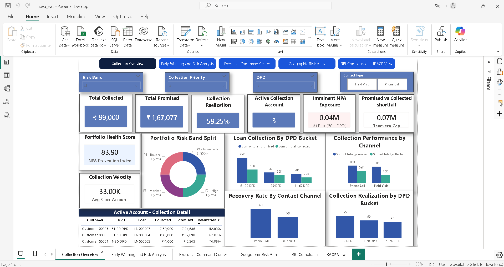
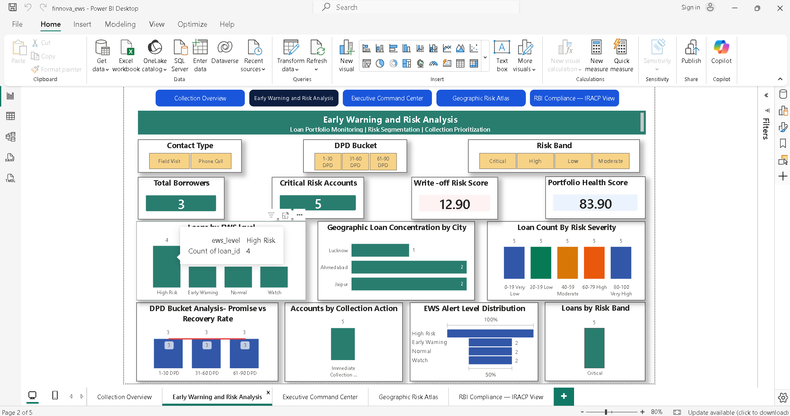
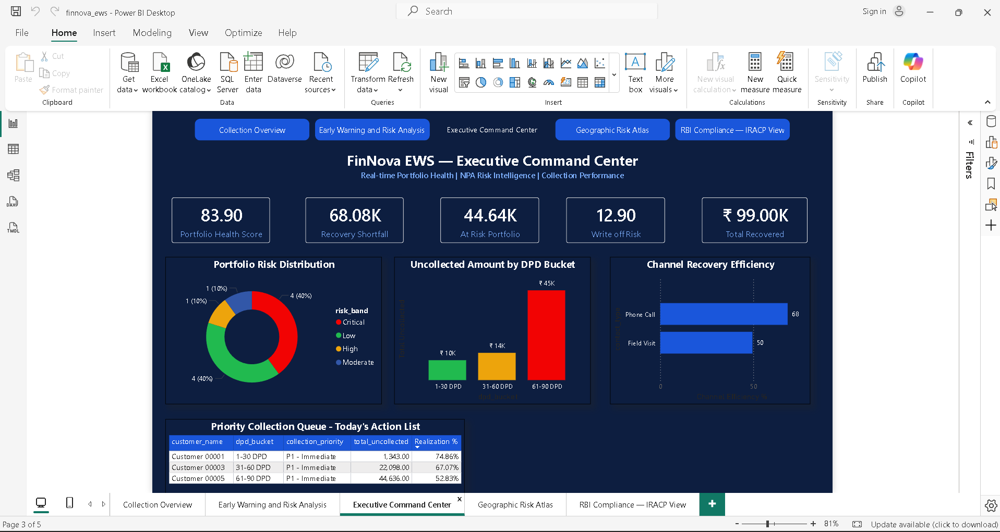
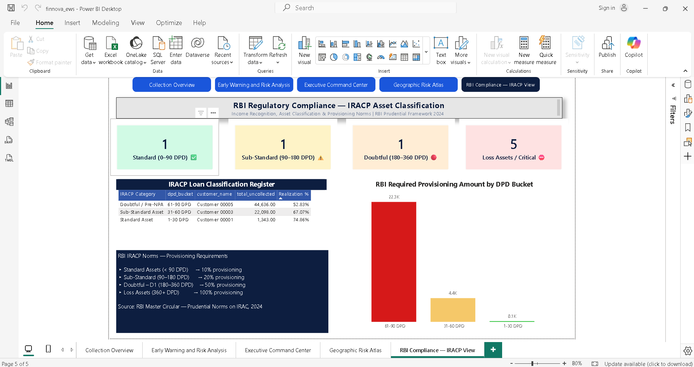

# FinNova Lending Early Warning System (EWS) & Collection Analytics

**End-to-End FinTech Analytics Project | Excel • PostgreSQL • SQL • Power BI**

An end-to-end lending analytics project that explores loan performance, collection efficiency, delinquency, and borrower risk indicators using Excel, PostgreSQL, SQL, and Power BI.

The project demonstrates how structured lending data can be transformed into analytical outputs and interactive dashboards to support collection monitoring, risk assessment, and operational decision-making.

> **Project type:** Portfolio project for learning and demonstration. The Early Warning System uses configured business rules; it is not a trained machine-learning model.

---

## Table of Contents

* [Project Overview](#project-overview)
* [Business Problem](#business-problem)
* [Project Objectives](#project-objectives)
* [Tools and Technologies](#tools-and-technologies)
* [Dataset Overview](#dataset-overview)
* [Project Workflow](#project-workflow)
* [SQL Scripts](#sql-scripts)
* [Power BI Dashboards](#power-bi-dashboards)
* [Key Metrics](#key-metrics)
* [Early Warning System Methodology](#early-warning-system-methodology)
* [Data Quality and Validation](#data-quality-and-validation)
* [How to Explore the Project](#how-to-explore-the-project)
* [Key Skills Demonstrated](#key-skills-demonstrated)
* [Limitations](#limitations)
* [Author](#author)

---

## Project Overview

FinNova EWS brings together lending data analysis, collection performance measurement, and rule-based risk monitoring.

The workflow covers three main stages:

1. **Excel:** Prepare and review lending-related data.
2. **PostgreSQL and SQL:** Organize relational data, validate data quality, calculate KPIs, and perform analytical queries.
3. **Power BI:** Present collection performance and risk indicators through five dashboard pages.

The project is designed to demonstrate practical data analytics skills in a financial-services context.

## Business Problem

Lending and collection teams need timely information to understand repayment behavior, identify overdue accounts, measure collection effectiveness, and prioritize follow-up activities.

Analyzing these activities separately can make it difficult to obtain a consistent view of portfolio performance.

This project uses a structured analytical workflow to explore these questions and present the results through SQL queries and Power BI dashboards.

## Project Objectives

* Analyze loan and repayment information.
* Measure collection performance using clearly defined KPIs.
* Examine overdue accounts using Days Past Due (DPD) indicators.
* Identify configured early warning signals.
* Analyze collection performance by loan and contact channel.
* Validate relationships between database tables.
* Present important portfolio indicators through interactive dashboards.
* Demonstrate simplified regulatory classification concepts for learning purposes.

## Tools and Technologies

| Tool               | Application                                                  |
| ------------------ | ------------------------------------------------------------ |
| Microsoft Excel    | Data preparation and source data review                      |
| PostgreSQL         | Relational database management                               |
| SQL                | Data validation, joins, aggregations, and analytical queries |
| Microsoft Power BI | Dashboard development and reporting                          |
| Power Query        | Data transformation                                          |
| DAX                | Measures and analytical calculations                         |
| Data Visualization | Communicating portfolio insights                             |

## Dataset Overview

The project uses six core relational tables:

| Table                 | Purpose                                               |
| --------------------- | ----------------------------------------------------- |
| `customer`            | Customer-related information                          |
| `loan`                | Loan details                                          |
| `repayment`           | Repayment and due-date information                    |
| `monthly_behaviour`   | Monthly borrower behavior indicators                  |
| `ews`                 | Early warning indicators and risk-related information |
| `collection_activity` | Collection interactions and collection amounts        |

The `data_dictionary.md` file documents dataset fields and their intended meanings.

**Data privacy:** Only synthetic or appropriately anonymized data should be published in this repository. No confidential borrower information should be included.

## Project Workflow

### 1. Excel — Data Preparation

* Reviewed the structure of the source workbook.
* Examined the lending-related tables and their fields.
* Prepared data for database analysis.
* Documented relevant fields in the data dictionary.

### 2. PostgreSQL — Database Setup

Created the `finnova_ews` database and organized the project data into six relational tables.

The database provides a foundation for validating relationships and analyzing lending and collection activity.

### 3. SQL — Data Analysis

Created seven SQL scripts covering:

* Database setup
* Data quality validation
* Collection KPI calculations
* Loan-level performance
* Early warning analysis
* Collection channel and DPD analysis
* Reusable analytical views

### 4. Power BI — Dashboard Development

Developed five dashboard pages to explore collection performance, risk indicators, management-level metrics, geographic exposure, and a simplified regulatory classification demonstration.

The dashboards are supported by the underlying project data and analytical logic.

---

## SQL Scripts

The repository contains seven SQL scripts.

| Script                        | Purpose                              |
| ----------------------------- | ------------------------------------ |
| `01_database_setup.sql`       | Database and table setup             |
| `02_data_quality.sql`         | Data quality and relationship checks |
| `03_collection_kpis.sql`      | Collection KPI calculations          |
| `04_performance_by_loan.sql`  | Loan-level performance analysis      |
| `05_ews_analysis.sql`         | Early Warning System analysis        |
| `06_channel_dpd_analysis.sql` | Collection channel and DPD analysis  |
| `07_analytical_views.sql`     | Reusable analytical views            |

### SQL concepts demonstrated

* `SELECT`, `WHERE`, and `ORDER BY`
* `JOIN` operations
* `GROUP BY` and aggregate functions
* `CASE` expressions
* Conditional calculations
* Data quality checks
* Referential integrity validation
* KPI calculations
* Loan-level and portfolio-level analysis
* Analytical views

The scripts are listed in their current repository location. If they are later moved into a `sql/` directory, update the file paths and instructions accordingly.

---

## Power BI Dashboards

The project contains five dashboard pages.

### 1. Collection Overview

Provides a consolidated view of collection performance and relevant collection KPIs.

### 2. Early Warning Risk Analysis

Explores configured early warning indicators and risk-related information used to identify accounts that may require additional attention.

### 3. Executive Command Center

Presents a management-oriented view of key lending and collection performance indicators.

### 4. Geographic Risk Atlas

Explores geographic patterns in the available lending portfolio and risk indicators.

### 5. RBI IRACP Classification — Demonstration

Demonstrates simplified asset-classification concepts through a Power BI dashboard.

**Regulatory disclaimer:** This dashboard is an educational demonstration. Its classifications and calculations should not be treated as verified regulatory reporting or a guarantee of RBI compliance. Actual regulatory requirements and their applicability must be independently validated.

---

## Key Metrics

The project examines several lending and collection indicators.

| Metric                   | Purpose                                                             |
| ------------------------ | ------------------------------------------------------------------- |
| Total Loan Portfolio     | Understand the size of the analyzed loan portfolio                  |
| Promised Amount          | Monitor amounts committed for collection                            |
| Collected Amount         | Measure recorded collection amounts                                 |
| Uncollected Amount       | Examine amounts remaining uncollected under the selected definition |
| Collection Realization % | Measure collections against the corresponding collection target     |
| Days Past Due (DPD)      | Examine repayment delinquency                                       |
| Early Warning Indicators | Identify accounts requiring additional monitoring                   |
| Loan-Level Performance   | Examine performance at the individual loan level                    |
| Channel Analysis         | Compare collection activity across contact channels                 |

### Collection Realization Formula

For a consistently defined collection population and reporting period:

**Collection Realization (%) = (Collected Amount ÷ Promised Amount) × 100**

The promised amount and collected amount must refer to the same collection records and reporting scope.

Repayment amounts due and amounts promised during collection activities are different measures. They should not be combined without a clearly documented business definition.

Final KPI values should be reconciled across Excel, PostgreSQL, and Power BI before being presented as definitive project results.

---

## Early Warning System Methodology

The project uses a **rule-based Early Warning System** to organize borrower risk indicators.

The general analytical process is:

1. Review available customer and loan information.
2. Examine repayment behavior and delinquency indicators.
3. Identify configured early warning signals.
4. Apply the risk-scoring rules implemented in the project.
5. Group accounts according to the configured risk categories.
6. Use the results to support analytical review and collection prioritization.

The system is intended to demonstrate how business rules and lending indicators can support risk monitoring.

**Important:** The EWS should not be described as a predictive machine-learning model. Its output depends on the rules, thresholds, and source data implemented in the project.

---

## Data Quality and Validation

Reliable analysis requires consistent data and valid relationships between tables.

The SQL workflow includes checks for:

* Referential integrity
* Orphan records
* Data consistency
* Collection KPI calculations
* Analytical result validation

During the project, the referential-integrity checks performed returned zero orphan records in the tables checked.

This result applies to the checks that were run; it does not guarantee that every possible data-quality issue has been eliminated.

Collection totals and risk counts should be reconciled across Excel, SQL, and Power BI to ensure that they use consistent record populations, date ranges, and business definitions.

---

## How to Explore the Project

### Option 1 — Review the Dashboards

View the five dashboard images above or open `finnova_ews.pdf` to review the dashboard pages.

### Option 2 — Explore the SQL Scripts

Review the seven SQL files in numerical order, beginning with database setup and continuing through data quality, KPI analysis, risk analysis, and analytical views.

### Option 3 — Open the Power BI Report

Download `finnova_ews.pbix` and open it using Microsoft Power BI Desktop.

Refreshing the report may require the original workbook, compatible data sources, and appropriate connection settings.

### Option 4 — Review the Excel Workbook

Open `FinNova_EWS_Desion_Intelligence.xlsx` to examine the workbook used in the project. Refer to `data_dictionary.md` for field definitions.

---

## Key Skills Demonstrated

* Microsoft Excel
* PostgreSQL
* SQL Query Writing
* Data Cleaning and Preparation
* Data Quality Validation
* Relational Data Analysis
* KPI Development
* Collection Performance Analysis
* Delinquency and DPD Analysis
* Rule-Based Risk Analysis
* Power BI Dashboard Development
* Power Query
* DAX
* Data Modeling
* Business Intelligence
* Financial and Operational Reporting
* Analytical Thinking
* Business Problem Solving

---

## Limitations

* This is a portfolio project, not a production lending or collection platform.
* The Early Warning System uses configured business rules rather than a trained machine-learning model.
* Regulatory classification logic is presented for educational demonstration only.
* Financial KPIs require consistent definitions and reconciliation across the source workbook, SQL results, and Power BI report.
* Results depend on the completeness, quality, and scope of the underlying data.
* The project does not independently establish regulatory compliance or guarantee future loan performance.

---

## Author

**Saurabh Kumar Pandey**

MBA — Information Technology & FinTech
Aspiring Data Analyst | Power BI Analyst | FinTech Analytics

Interested in opportunities across:

* BFSI and FinTech Analytics
* Data Analytics and Business Intelligence
* MIS Reporting
* Power BI Development
* Lending and Collection Analytics
* Risk and Operations Analytics

### Connect with Me

* **GitHub Profile:** [saurabhpandey95](https://github.com/saurabhpandey95)
* **Project Repository:** [FinNova Lending Early Warning System](https://github.com/saurabhpandey95/finnova-lending-early-warning-system)

---

*Developed for learning, portfolio development, and analytical demonstration. This project does not constitute financial, credit, or regulatory advice.*
