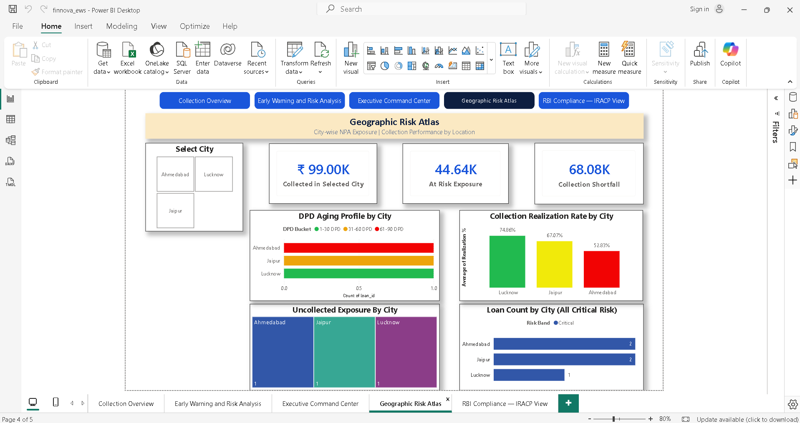

# FinNova EWS & Collection Analytics

### End-to-End FinTech Analytics Project | Excel • PostgreSQL • SQL • Power BI


An end-to-end lending analytics project designed to analyze loan delinquency, collection performance, borrower risk indicators, and early warning signals.

The project demonstrates how structured lending data can be transformed into actionable business insights using Excel, PostgreSQL, SQL, and Power BI.

The objective is to help lending and collection teams monitor portfolio performance, identify potentially high-risk accounts, analyze collection efficiency, and prioritize follow-up activities.

---

## Repository Structure

```
finnova-lending-early-warning-system/
│
├── sql/
│   ├── 01_database_setup.sql
│   ├── 02_data_quality.sql
│   ├── 03_collection_kpis.sql
│   ├── 04_performance_by_loan.sql
│   ├── 05_ews_analysis.sql
│   ├── 06_channel_dpd_analysis.sql
│   └── 07_analytical_views.sql
│
├── dashboards/
│   ├── screenshots/
│   │   ├── 01_Collection_Overview.png
│   │   ├── 02_Early_Warning_Risk_Analysis.png
│   │   ├── 03_Executive_Command_Center.png
│   │   ├── 04_Geographic_Risk_Atlas.png
│   │   └── 05_RBI_IRACP_Compliance.png
│   ├── finnova_ews.pbix
│   └── finnova_ews.pdf
│
├── data/
│   └── FinNova_EWS_Decision_Intelligence.xlsx
│
├── data_dictionary.md
├── README.md
├── .gitignore
└── LICENSE
```

---

## Project Overview

**Project Name:** FinNova Lending Early Warning System (EWS)

**Domain:** Banking, Financial Services, and FinTech

**Project Type:** End-to-End Data Analytics and Business Intelligence

**Tools Used:**

- Microsoft Excel
- PostgreSQL
- SQL
- Microsoft Power BI
- DAX
- Power Query
- Data Visualization

### Business Objectives

- Analyze loan repayment and collection performance.
- Identify accounts showing potential early warning signals.
- Monitor Days Past Due (DPD) and delinquency patterns.
- Evaluate collection performance across channels and loans.
- Support risk-based collection prioritization.
- Present portfolio insights through interactive dashboards.
- Demonstrate regulatory classification concepts through a simplified RBI IRACP-related dashboard.

---

## Business Problem

Lending organizations need reliable information to understand repayment behavior, monitor overdue accounts, measure collection effectiveness, and identify emerging credit risk.

When these activities are analyzed separately, it becomes difficult to obtain a consistent view of portfolio performance.

FinNova EWS addresses this analytical challenge by integrating data preparation, SQL-based analysis, risk indicators, and interactive Power BI reporting into a single project workflow.

### Key Business Questions

1. How much has been promised for collection, and how much has actually been collected?
2. Which loans require additional collection attention?
3. What early warning indicators are associated with higher-risk accounts?
4. How does delinquency vary across DPD buckets?
5. How does collection performance vary by channel?
6. Which portfolio segments require closer monitoring?
7. How can management monitor collection and risk KPIs in one place?

---

## Technology Stack

| Technology         | Purpose                                                                          |
| ------------------ | -------------------------------------------------------------------------------- |
| Microsoft Excel    | Data preparation, inspection, and source data management                         |
| PostgreSQL         | Relational database creation and data storage                                    |
| SQL                | Data quality checks, joins, aggregations, KPI calculations, and analytical views |
| Microsoft Power BI | Interactive dashboards and business reporting                                    |
| Power Query        | Data transformation and preparation                                              |
| DAX                | Measures and analytical calculations                                             |
| Data Visualization | Communicating portfolio performance and risk indicators                          |

---

## Project Workflow

### Step 1: Excel — Data Preparation

Prepared and reviewed lending-related datasets covering customers, loans, repayments, borrower behavior, early warning indicators, and collection activities.

Key activities:

- Reviewed dataset structure and field definitions.
- Examined data types and record consistency.
- Prepared source tables for database analysis.
- Documented important fields in the data dictionary.

### Step 2: PostgreSQL — Database Setup

Created a relational database named `finnova_ews`.

The project uses six core tables:

- `customer`
- `loan`
- `repayment`
- `monthly_behaviour`
- `ews`
- `collection_activity`

The tables represent different aspects of borrower information, loan details, repayment schedules, monthly behavior, early warning indicators, and collection activities.

### Step 3: SQL — Data Analysis

Developed seven SQL scripts to organize the analytical workflow.

The analysis includes:

- Database and table creation.
- Data quality validation.
- Referential integrity checks.
- Collection KPI calculations.
- Loan-level performance analysis.
- Early warning risk analysis.
- Channel and DPD analysis.
- Reusable analytical views.

### Step 4: Power BI — Dashboard Development

Developed five dashboard pages to communicate portfolio performance, collection activity, risk indicators, geographic exposure, and regulatory classification concepts.

The dashboards support visual exploration of the project's analytical results.

---

## SQL Scripts

All seven SQL scripts are located in the `sql/` folder.

| File                              | Purpose                                 |
| --------------------------------- | --------------------------------------- |
| `sql/01_database_setup.sql`       | Database and table setup                |
| `sql/02_data_quality.sql`         | Data quality and integrity checks       |
| `sql/03_collection_kpis.sql`      | Collection performance KPI calculations |
| `sql/04_performance_by_loan.sql`  | Loan-level performance analysis         |
| `sql/05_ews_analysis.sql`         | Early Warning System analysis           |
| `sql/06_channel_dpd_analysis.sql` | Collection channel and DPD analysis     |
| `sql/07_analytical_views.sql`     | Creation of reusable analytical views   |

### SQL Skills Demonstrated

- SELECT statements and filtering
- JOIN operations
- GROUP BY and aggregate functions
- CASE expressions
- Conditional calculations
- Data quality checks
- Referential integrity validation
- Loan-level and portfolio-level analysis
- KPI calculations
- Analytical views

---

## Power BI Dashboards

All dashboard files are located in the `dashboards/` folder.
Screenshots are in `dashboards/screenshots/`.

### 1. Collection Overview

Provides an overview of collection performance and important collection KPIs.

[](dashboards/screenshots/01_Collection_Overview.png)

### 2. Early Warning Risk Analysis

Focuses on borrower risk indicators and early warning signals used to identify accounts requiring additional attention.

[](dashboards/screenshots/02_Early_Warning_Risk_Analysis.png)

### 3. Executive Command Center

Presents a consolidated view of important portfolio and collection performance indicators for management monitoring.

[](dashboards/screenshots/03_Executive_Command_Center.png)

### 4. Geographic Risk Atlas

Supports the analysis of geographic patterns in portfolio exposure and risk.

[](dashboards/screenshots/04_Geographic_Risk_Atlas.png)

### 5. RBI IRACP Classification — Demonstration

Demonstrates regulatory classification concepts using simplified project logic.

[](dashboards/screenshots/05_RBI_IRACP_Compliance.png)

**Important:** The RBI IRACP dashboard is an educational demonstration. Its calculations and classification logic should not be treated as verified regulatory reporting without independent validation against applicable RBI requirements.

---

## Key KPIs and Analytical Areas

| KPI / Analysis           | Business Purpose                                          |
| ------------------------ | --------------------------------------------------------- |
| Total Loan Portfolio     | Understand the scale of the loan portfolio                |
| Collection Realization % | Measure collections against the defined collection target |
| Promised Amount          | Monitor amounts committed for collection                  |
| Collected Amount         | Measure actual collections                                |
| Uncollected Amount       | Identify amounts remaining uncollected                    |
| Days Past Due (DPD)      | Monitor repayment delinquency                             |
| Early Warning Indicators | Identify accounts requiring closer monitoring             |
| Risk Segmentation        | Compare portfolio risk across relevant segments           |
| Channel Analysis         | Evaluate collection performance by contact channel        |
| Loan-Level Performance   | Examine performance at individual loan level              |

### Collection Realization

The general calculation used for collection realization is:

**Collection Realization % = (Collected Amount / Promised Amount) × 100**

The numerator and denominator must refer to the same reporting period and collection population.

**Note:** Repayment amounts due and amounts promised during collection activities are different measures. Interpret collection realization using the source table and business definition specified for the particular analysis.

---

## Early Warning System Methodology

The project uses a rule-based Early Warning System to organize borrower risk indicators.

The workflow combines available borrower behavior and loan-related information to support risk monitoring and collection prioritization.

The analytical process includes:

1. Reviewing borrower and loan information.
2. Examining repayment and delinquency indicators.
3. Identifying configured early warning signals.
4. Applying the project's risk scoring logic.
5. Segmenting accounts according to the configured risk rules.
6. Supporting follow-up prioritization through analytical reporting.

The EWS is a rule-based analytical approach, not a trained machine-learning prediction model.

Risk scores and classifications should be interpreted according to the rules implemented in the SQL scripts and Power BI report.

---

## Data Quality and Validation

Data quality is important for reliable financial reporting.

The project includes SQL checks for:

- Referential integrity between related tables.
- Orphan records.
- Record consistency.
- Collection KPI calculations.
- Analytical result validation.

The database validation work identified zero orphan records in the tables checked during the project.

Financial KPIs and record counts should be reconciled across Excel, PostgreSQL, and Power BI before the report is used for decision-making.

---

## How to Set Up Locally

Follow these steps to reproduce the project on your machine.

### Prerequisites

- PostgreSQL 14 or later
- Microsoft Power BI Desktop (latest version)
- Microsoft Excel 2016 or later

### Step-by-Step Setup

1. **Clone the repository**
   ```bash
   git clone https://github.com/saurabhpandey95/finnova-lending-early-warning-system.git
   cd finnova-lending-early-warning-system
   ```

2. **Create the database**
   Open your PostgreSQL client (pgAdmin or psql) and run:
   ```sql
   CREATE DATABASE finnova_ews;
   ```

3. **Run SQL scripts in order**
   All scripts are in the `sql/` folder. Execute each in sequence:
   ```
   sql/01_database_setup.sql       → Creates all six tables
   sql/02_data_quality.sql         → Validates data integrity
   sql/03_collection_kpis.sql      → Calculates collection KPIs
   sql/04_performance_by_loan.sql  → Loan-level analysis
   sql/05_ews_analysis.sql         → Early warning risk analysis
   sql/06_channel_dpd_analysis.sql → Channel and DPD analysis
   sql/07_analytical_views.sql     → Creates reusable views
   ```

4. **Load source data**
   Import data from `data/FinNova_EWS_Decision_Intelligence.xlsx` into the respective PostgreSQL tables using pgAdmin's import tool or `COPY` commands.

5. **Open the Power BI report**
   Open `dashboards/finnova_ews.pbix` in Power BI Desktop.
   Update the PostgreSQL connection settings to point to your local database.

6. **Review the dashboards**
   Alternatively, open `dashboards/finnova_ews.pdf` to review all dashboard pages without Power BI Desktop.

---

## Project Files

| File | Description |
| ---- | ----------- |
| `data/FinNova_EWS_Decision_Intelligence.xlsx` | Excel source workbook with all synthetic lending data |
| `dashboards/finnova_ews.pbix` | Interactive Power BI project file |
| `dashboards/finnova_ews.pdf` | Dashboard PDF export for quick review |
| `dashboards/screenshots/` | PNG screenshots of all five dashboard pages |
| `sql/01_database_setup.sql` | Database and table creation script |
| `sql/02_data_quality.sql` | Data quality and integrity checks |
| `sql/03_collection_kpis.sql` | Collection KPI analysis |
| `sql/04_performance_by_loan.sql` | Loan-level performance analysis |
| `sql/05_ews_analysis.sql` | Early warning analysis |
| `sql/06_channel_dpd_analysis.sql` | Channel and DPD analysis |
| `sql/07_analytical_views.sql` | Reusable analytical views |
| `data_dictionary.md` | Field definitions for all six core database tables |
| `LICENSE` | MIT License |

---

## Skills Demonstrated

- Data Cleaning and Preparation
- Microsoft Excel
- PostgreSQL
- SQL Query Writing
- Data Quality Validation
- Relational Data Analysis
- KPI Development
- Collection Performance Analysis
- Delinquency and DPD Analysis
- Rule-Based Risk Analysis
- Power BI Dashboard Development
- Power Query
- DAX
- Data Modeling
- Business Intelligence
- Financial and Operational Reporting
- Analytical Thinking
- Business Problem Solving

---

## Project Limitations

- The project is a portfolio demonstration, not a production lending platform.
- The EWS uses configured rules rather than a trained predictive model.
- The RBI IRACP-related dashboard uses simplified demonstration logic.
- Financial KPIs should be reconciled across source data, SQL results, and Power BI before business use.
- Results depend on the quality, completeness, and definitions of the underlying data.
- All data used is synthetic and does not represent any real borrower or organization.

---

## Author

**Saurabh Kumar Pandey**

MBA — Information Technology & FinTech
Aspiring Data Analyst | Power BI Analyst | FinTech Analytics

Interested in opportunities across:

- BFSI and FinTech Analytics
- Data Analytics and Business Intelligence
- MIS Reporting
- Power BI Development
- Lending and Collection Analytics
- Risk and Operations Analytics

### Connect

- GitHub: [saurabhpandey95](https://github.com/saurabhpandey95)
- LinkedIn: [linkedin.com/in/saurabhkumarpandey](https://www.linkedin.com/in/saurabhkumarpandey)
- Project Repository: [FinNova Lending Early Warning System](https://github.com/saurabhpandey95/finnova-lending-early-warning-system)

---

*This project was developed for learning, portfolio development, and analytical demonstration purposes. It does not constitute financial, credit, or regulatory advice.*
